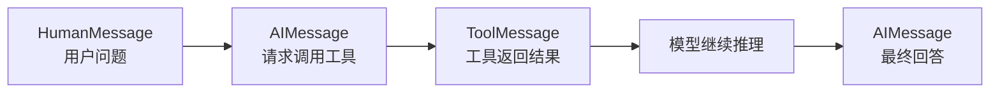
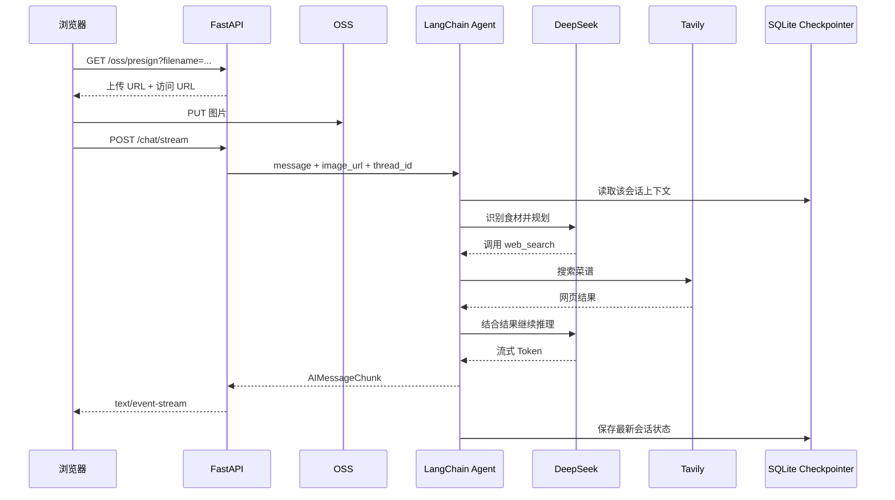

# 01. 这次到底学了什么

这份笔记覆盖黑马程序员 AI 课程的第 `00–28` 节，也就是进入 Agent 进阶之前的第一阶段。它包含三条主线：

1. **AI 通识与底层原理**：人工智能、神经网络、大语言模型分别是什么，它们之间是什么关系；
2. **大模型 API 与开发环境**：怎样申请模型服务、配置密钥、调用接口，以及为什么 API 本身“不记得”上一轮对话；
3. **LangChain 与 Agent 实战**：怎样用 LangChain 组织模型、消息、提示词、工具和记忆，最后完成「AI 私厨」。

前面的 Python 和 FastAPI 细节已经分别记录在[《Python 从基础到实战》](/article/Python基础到实战)和[《FastAPI 从入门到异步数据库实战》](/article/FastAPI)中，这里不再重复语法，只保留它们与 AI 应用连接的部分。

课程编号与知识点的对应关系如下：

| 课程编号 | 主要内容 | 最终沉淀下来的能力 |
| --- | --- | --- |
| 00 | 课程介绍 | 建立整门课的学习路线 |
| 01–05 | AI 通识、神经网络、LLM、应用与服务 | 知道模型能做什么、为什么会产生幻觉 |
| 06–08 | DeepSeek、阿里云百炼、Ollama | 能在云端或本地获得模型服务 |
| 09–12 | API 规范、会话记忆、开发环境、编程调用 | 能独立写一个最小聊天程序 |
| 13–18 | LangChain、Agent、模型、消息、提示词 | 能用统一抽象组织一次模型调用 |
| 19–20 | 自定义工具与 Tavily | 让模型具备查询外部世界的能力 |
| 21–23 | 短期记忆、持久化、记忆管理 | 让 Agent 能跨多轮对话并控制上下文 |
| 24–27 | 需求分析、LangSmith、服务端、OSS、AI 私厨 | 完成一个可以演示的完整 Agent 应用 |
| 28 | Agent 进阶前的版本升级 | 更新依赖与 DeepSeek 模型配置，认识新版 v3 流式接口 |

这一阶段最重要的认识不是“记住多少 LangChain 函数”，而是建立下面这条链路：

> 用户请求 → 应用组织上下文 → 模型推理 → 需要时调用工具 → 工具结果回到模型 → 生成回答 → 应用保存状态并返回

LangChain 负责把这条链路中的模型、消息、工具和状态抽象成统一接口；FastAPI 负责把 Agent 变成可以被浏览器访问的服务；LangSmith 则负责观察 Agent 内部究竟发生了什么。

# 02. AI、神经网络与大语言模型

## 2.1 几个经常混用的概念

这些概念不是并列关系，而是层层包含或交叉的关系：

| 概念 | 关注点 | 例子 |
| --- | --- | --- |
| 人工智能 AI | 让机器表现出类似智能的能力 | 推荐系统、语音识别、下棋程序 |
| 机器学习 ML | 让程序从数据中学习规律 | 分类、回归、聚类 |
| 深度学习 DL | 用多层神经网络学习复杂表示 | 图像识别、语音识别、LLM |
| 生成式 AI | 生成文本、图片、音频等内容 | ChatGPT、文生图、语音合成 |
| 大语言模型 LLM | 在海量文本上训练、以 Token 为基本单位的语言模型 | DeepSeek、Qwen、GPT |

可以简单理解为：**AI 是目标，机器学习是主要方法，深度学习是当前最强的技术路线，生成式 AI 和 LLM 是落地成果。**

## 2.2 神经网络在做什么

一个最简单的神经元接收若干输入，给每个输入乘一个权重，加上偏置，再经过激活函数得到输出：

```text
输入 × 权重 + 偏置 → 激活函数 → 输出
```

把它堆叠起来就形成神经网络：

- **输入层**接收原始特征，例如图像像素或文本向量；
- **隐藏层**逐层提取更抽象的特征；
- **输出层**给出分类结果、数值或下一个 Token 的概率。

训练阶段分为前向传播和反向传播。前向传播先得到预测结果，损失函数衡量预测与正确答案的差距，反向传播再利用梯度调整权重。反复迭代后，网络会逐渐拟合训练数据中的规律。

训练完成后进入推理阶段。推理只做前向计算，不再更新权重。我们调用大模型 API 时，消耗的主要就是推理算力。

神经网络并不等于“数据库检索”。训练得到的知识被压缩进参数中，因此模型能够泛化，却无法天然保证事实正确，也不能自动知道训练结束之后发生的事情。

## 2.3 大语言模型怎样生成文字

LLM 的核心任务可以概括成一句话：**根据前面的 Token，预测下一个 Token 的概率分布。**

例如输入“今天天气真”，模型可能给“好”较高概率，给“冷”较低概率。选定一个 Token 后，把它追加到上下文中，再继续预测，直到遇到结束标记或达到长度上限。

这里有三个关键概念：

- **Token**：模型处理文本的最小片段，不一定等于一个汉字或一个单词；
- **上下文窗口**：模型一次请求最多能看到的 Token 数量，包括系统提示词、历史消息、工具结果和本轮问题；
- **自回归生成**：每次生成一个 Token，再把它作为下一次预测的输入。

因此，模型看起来能连续回答，本质上却是在一轮又一轮地做条件概率预测。

## 2.4 常用采样参数

| 参数 | 作用 | 实践理解 |
| --- | --- | --- |
| `temperature` | 调整概率分布的随机程度 | 数值低更稳定、更保守；数值高更发散 |
| `top_p` | 核采样，只保留累计概率达到 `p` 的候选 Token | 数值低候选更少、更聚焦；数值高候选更多、更随机 |
| `max_tokens` | 限制单次输出长度 | 防止无限生成，也会截断过长回答 |
| `timeout` | 请求超时时间 | 生产环境必须设置 |
| `max_retries` | 网络或限流失败后的最大重试次数 | 重试要有上限，非幂等操作需谨慎 |

`temperature` 和 `top_p` 都在控制随机性，通常调整其中一个即可。课程资料中关于 `top_p` 数值方向的描述需要纠正：**较小的 `top_p` 会让候选集合更集中，不是更多样；较大的 `top_p` 才会保留更多候选。**

## 2.5 为什么会有幻觉

LLM 优化的是“生成合理文本”，不是“数据库查询返回绝对正确的值”。常见幻觉来源包括：

- 参数中的知识过时或不完整；
- 没有上下文依据，却仍然给出了确定性口吻；
- 工具调用失败后，模型自行补全结果；
- 提示词约束不清，模型输出格式漂移。

工程上的应对方式不是要求模型“保证不要出错”，而是增加可验证机制：

1. 用 RAG 提供知识依据；
2. 用工具获取实时数据；
3. 用结构化输出约束字段；
4. 保留来源、日志和 LangSmith Trace；
5. 对关键业务做人工审核或程序校验。

本阶段只学到 LangChain 入门，后续的 RAG、人工审核和生产级 Agent 会把这几项能力逐步补齐。

# 03. 大模型应用、模型服务与 API

## 3.1 应用和模型不是一回事

一个完整的大模型应用至少包含两层：

- **模型服务**：负责接收 Prompt，完成推理并返回 Token；
- **应用层**：管理用户、会话、提示词、工具、权限、数据库、前端和业务规则。

模型服务只回答“这一次输入对应什么输出”，并不知道你的用户名、聊天列表或数据库事务。会话记忆、历史查询、文件上传、鉴权和失败提示都由应用层负责。

## 3.2 云端服务与本地模型

课程体验了三种模型获取方式：

| 平台 | 运行位置 | 优点 | 适合场景 |
| --- | --- | --- | --- |
| DeepSeek | 云端 | 接入简单、调用成本低、支持流式输出 | 日常开发和学习 |
| 阿里云百炼 | 云端 | 模型选择多、OpenAI 兼容接口方便 | 需要 Qwen 或多模型切换 |
| Ollama | 本机 | 数据不出本机、离线可用、无需按 Token 付费 | 隐私要求、本地实验 |

云端 API 的典型流程是：注册账号 → 创建 API Key → 配置环境变量 → 安装 SDK → 请求接口。

本地 Ollama 的流程是：安装客户端 → 拉取模型 → 启动本地服务 → 使用兼容接口调用。它省掉了远程网络和云端密钥，但会占用本地显存/内存，推理速度取决于机器配置。

## 3.3 开发环境与密钥管理

不要把密钥直接写进代码，也不要提交到 Git。项目使用 `.env` 管理配置，代码中通过 `os.getenv()` 或 `load_dotenv()` 读取：

```python
import os
from dotenv import load_dotenv

load_dotenv()

api_key = os.getenv("DEEPSEEK_API_KEY")
```

当前资料涉及的环境变量包括：

```text
DEEPSEEK_API_KEY
TAVILY_API_KEY
LANGSMITH_API_KEY
LANGSMITH_TRACING
LANGSMITH_PROJECT
OSS_ACCESS_KEY_ID
OSS_ACCESS_KEY_SECRET
OSS_BUCKET
```

`.env` 只解决“配置和代码分离”，不是加密方案。生产环境更适合使用部署平台的 Secret、IAM 角色或密钥管理服务，并为不同环境使用不同密钥。

## 3.4 大模型 API 的通用结构

大多数聊天接口都遵循相似结构：

```text
POST /chat/completions
Authorization: Bearer <API_KEY>
Content-Type: application/json
```

请求中最关键的是 `messages`：

```json
{
  "model": "deepseek-flash",
  "messages": [
    {"role": "system", "content": "你是一名 AI 助教"},
    {"role": "user", "content": "解释一下什么是 Token"}
  ]
}
```

常见角色有四种：

| 角色 | 含义 |
| --- | --- |
| `system` | 系统规则、身份、边界和全局约束 |
| `user` | 用户本轮输入 |
| `assistant` | 模型之前的回复 |
| `tool` | 工具执行后的结果，供模型继续推理 |

不同厂商的字段可能略有差异，但支持 OpenAI 兼容协议后，通常只需要替换 `api_key`、`base_url` 和模型名，SDK 代码可以基本保持不变。

## 3.5 模型版本提醒

课程早期录制时使用 `deepseek-chat`。第 28 节说明模型服务已经更新，课程示例迁移为 `deepseek-flash`，旧名称后续可能停止提供。模型名、可用性、限流和请求参数都由平台控制，因此应以当前账号控制台和官方文档为准；迁移时不必把所有旧代码机械替换成同一个名称，而要结合当前环境验证。

第 28 节还通过 `uv sync --upgrade` 更新 LangChain 相关依赖。升级后，模型的初始化方式、工具调用和流式接口都可能发生变化，只改模型名并不足以保证旧代码继续工作。

课程在新版示例中使用 `init_chat_model()`，并通过 `extra_body` 关闭 DeepSeek 的 thinking：

```python
from langchain.chat_models import init_chat_model

model = init_chat_model(
    "deepseek-flash",
    extra_body={"thinking": {"type": "disabled"}},
)
```

`ChatDeepSeek` 也可以接收相同的 `extra_body` 配置：

```python
from langchain_deepseek import ChatDeepSeek

model = ChatDeepSeek(
    model="deepseek-flash",
    extra_body={"thinking": {"type": "disabled"}},
)
```

`thinking` 是 DeepSeek 服务侧的扩展参数，不是 LangChain 或所有 OpenAI 兼容平台的通用参数。课程关闭 thinking，主要是作为兼容性措施：在部分工具调用、结构化输出等场景中，默认 thinking 可能与当前 LangChain 集成不兼容。它不表示所有普通对话都必须关闭思考，是否开启要结合模型、集成包和调用场景判断。

迁移旧代码时可按下面的顺序排查：

1. 检查当前账号控制台和官方文档中的模型名，确认 `deepseek-chat` 是否仍可用，以及是否应迁移到 `deepseek-flash`；
2. 检查 LangChain、`langchain-deepseek` 等集成包版本，必要时通过 `uv sync --upgrade` 更新并重新运行最小示例；
3. 如果工具调用或结构化输出出现 thinking 兼容问题，再传入 `extra_body={"thinking": {"type": "disabled"}}`，不要把它当成所有请求的固定开关。

## 3.6 最小 API 调用

课程中的 `1.1_OpenAI.ipynb` 使用 OpenAI SDK 访问 DeepSeek。下面示例已经按照当前模型版本把模型名迁移为 `deepseek-flash`：

```python
from openai import OpenAI

client = OpenAI(
    api_key=os.getenv("DEEPSEEK_API_KEY"),
    base_url="https://api.deepseek.com",
)

response = client.chat.completions.create(
    model="deepseek-flash",
    messages=[
        {"role": "system", "content": "你是一名友好的 AI 助教。"},
        {"role": "user", "content": "用一句话解释大语言模型。"},
    ],
)

print(response.choices[0].message.content)
```

这段代码虽然短，却包含了完整的调用边界：

- `base_url` 决定请求发往哪个兼容服务；
- `api_key` 完成身份认证；
- `model` 选择具体模型；
- `messages` 决定上下文；
- `response.choices[0].message.content` 是最终文本。

## 3.7 流式输出

普通 `create()` 要等模型生成完整回答后才返回；流式调用则会不断返回增量片段。聊天页面能逐字显示，靠的就是流式响应。

```python
stream = client.chat.completions.create(
    model="deepseek-flash",
    messages=[{"role": "user", "content": "写一段短视频文案"}],
    stream=True,
)

for chunk in stream:
    content = chunk.choices[0].delta.content
    if content:
        print(content, end="", flush=True)
```

流式输出的工程重点是：必须过滤空片段、正确处理结束信号，并确保网络断开时不会留下半截状态。

# 04. 为什么大模型 API “没有记忆”

## 4.1 一次请求就是一个独立快照

API 本身是无状态的。第一次发送“我叫虎哥”，第二次只发送“我最喜欢什么动物”，模型看不到第一条消息，自然无法回答。

所谓“会话记忆”，本质上是应用每次把历史消息重新拼进请求：

```python
messages = [
    {"role": "user", "content": "你好，我叫虎哥，我最喜欢猫猫。"},
    {"role": "assistant", "content": "你好虎哥，很高兴认识你。"},
    {"role": "user", "content": "我最喜欢什么动物？"},
]
```

模型每次只看到这次传入的完整 `messages`，并不知道数据库里还有多少其他会话。

## 4.2 记忆带来的成本与风险

手工维护历史消息看似简单，实际会遇到：

- 历史越长，输入 Token 越多，费用和延迟越高；
- 超过上下文窗口后，请求会失败或被迫丢弃内容；
- 不同用户的会话必须严格隔离；
- 历史中可能包含密钥、个人信息和工具返回的敏感内容；
- 只做“全部追加”，很快会把无效消息也带进上下文。

这也是后来需要 `checkpointer`、`thread_id` 和记忆管理策略的原因：**把“保存历史”与“决定哪些历史进入本轮上下文”分开处理。**

# 05. LangChain：把调用链路抽象成统一接口

## 5.1 LangChain、LangGraph 与 Agent 的关系

这一阶段的代码入口主要是 `create_agent`。可以先建立如下层次：

- **LangChain**：提供模型、消息、工具、结构化输出等基础抽象；
- **LangGraph**：为有状态、多步骤工作流提供状态图和检查点能力；
- **Agent**：让模型在“推理—调用工具—读取结果—继续推理”的循环中完成任务。

`create_agent` 是高层的 Agent 创建入口。我们传入模型、工具、系统提示词和检查点，它负责组织底层循环。当前阶段不需要手写复杂图结构，后续课程才会深入 LangGraph。

## 5.2 安装依赖

课程项目用 `uv` 管理依赖，核心包可以概括为：

```bash
uv add langchain langchain-deepseek
uv add langchain-tavily
uv add langgraph-checkpoint-sqlite
```

不同模型提供商需要额外的集成包，例如阿里云百炼可以使用 `langchain-community` 与 `dashscope`。包名和可用模型会随版本变化，应以当前安装版本的官方文档为准。

## 5.3 初始化模型

最简单的写法是让 `init_chat_model` 根据模型名推断提供商：

```python
from langchain.chat_models import init_chat_model

model = init_chat_model(model="deepseek-flash")
```

如果服务提供 OpenAI 兼容接口，也可以显式指定提供商、地址和密钥：

```python
model = init_chat_model(
    model="qwen-max",
    model_provider="openai",
    base_url=os.getenv("DASHSCOPE_BASE_URL"),
    api_key=os.getenv("DASHSCOPE_API_KEY"),
)
```

当 LangChain 没有对应的官方封装时，可以使用社区模型类；社区类未覆盖的平台，也可以基于 OpenAI 兼容接口接入。选择顺序可以记为：

1. 官方模型集成；
2. 兼容协议的 `init_chat_model`；
3. 社区模型类；
4. 自定义封装。

## 5.4 阻塞调用与流式调用

模型对象和 Agent 都支持两种常见调用方式：

| 方式 | 行为 | 适用场景 |
| --- | --- | --- |
| `invoke` | 等待完整结果后返回 | 后台任务、需要完整对象再处理 |
| `stream` | 按增量片段返回 | 聊天界面、实时反馈 |

模型调用可以直接传字符串：

```python
response = model.invoke("你是谁？")

for chunk in model.stream("你是谁？"):
    print(chunk.content, end="", flush=True)
```

Agent 调用则必须传包含 `messages` 的字典，因为 Agent 需要完整消息状态：

```python
response = agent.invoke({
    "messages": [{"role": "user", "content": "杭州适合周末去哪里？"}]
})

for chunk, metadata in agent.stream(
    {"messages": [{"role": "user", "content": "杭州适合周末去哪里？"}]},
    stream_mode="messages",
):
    if chunk.content:
        print(chunk.content, end="", flush=True)
```

`stream_mode="messages"` 返回“消息片段 + 元数据”的二元组。元数据能帮助判断片段来自哪个节点、哪个模型或哪个工具。

### 5.4.1 第 28 节：新的 `stream_events` v3

第 28 节还演示了 Agent 的新版事件流。它使用 `stream_events(..., version="v3")`，再通过返回对象的 `.messages` 投影读取模型消息：

```python
from langchain_core.messages import HumanMessage

stream = agent.stream_events(
    {"messages": [HumanMessage("你好啊~")]},
    version="v3",
)

for message in stream.messages:
    for token in message.text:
        print(token, end="", flush=True)
```

在课程使用的 LangChain `1.4.7` 中，`version="v3"` 仍属于实验性 API。v3 返回 `GraphRunStream`，`.messages` 是其中的消息投影，`message.text` 则用于逐段读取文本；接口以后仍可能调整，因此升级 LangChain 后应重新运行示例确认。

调用 v3 时不要再同时传 `stream_mode="messages"`。两者代表不同的流式调用方式，参数混用会产生冲突。AI 私厨项目实际使用的仍是 `agent.stream(..., stream_mode="messages")`，这段现有实现应保留；本节示例用于认识新版接口和后续迁移方向，不需要全局替换项目代码。

## 5.5 消息类型

LangChain 把所有消息统一为 `BaseMessage`，常用子类如下：

| 类型 | 角色 | 典型内容 |
| --- | --- | --- |
| `SystemMessage` | `system` | 身份、规则、背景与输出要求 |
| `HumanMessage` | `user` | 用户文本或多模态输入 |
| `AIMessage` | `assistant` | 模型文本、工具调用请求、元数据 |
| `ToolMessage` | `tool` | 工具执行结果 |

一次带工具的回答通常不是两条消息，而是更长的事件链：



打印完整 `response["messages"]` 比只打印最后一条文本更有价值，因为它能揭示模型调用了什么工具、传了什么参数，以及工具返回了什么。

## 5.6 多模态消息

支持视觉的模型可以接收图片。远程图片直接传 URL：

```python
from langchain.messages import HumanMessage

message = HumanMessage([
    {"type": "text", "text": "描述图片里有哪些食材"},
    {"type": "image", "url": "https://example.com/ingredients.jpg"},
])
```

本地文件无法被云端模型直接访问时，先读取字节并做 Base64 编码：

```python
import base64

with open("ingredients.jpg", "rb") as file:
    image_b64 = base64.b64encode(file.read()).decode("utf-8")

message = HumanMessage([
    {
        "type": "image",
        "base64": image_b64,
        "mime_type": "image/jpeg",
    },
    {"type": "text", "text": "这些食材能做什么菜？"},
])
```

需要注意：模型必须支持视觉；图片越大，Token 与传输成本越高；Base64 会增加请求体体积，生产环境通常更偏好对象存储 URL。

# 06. 提示词工程

## 6.1 系统提示词是 Agent 的行为协议

`system_prompt` 会影响整轮会话。一条可维护的系统提示词通常按以下顺序组织：

| 部分 | 回答的问题 |
| --- | --- |
| 身份 Identity | 你是谁，服务谁，采用什么语气 |
| 指令 Instructions | 必须做什么，禁止做什么 |
| 示例 Examples | 怎样的输入对应怎样的输出 |
| 上下文 Context | 本轮可参考的资料、边界和补充信息 |

课程建议用 Markdown 标题与列表表达层级，用 XML 标签圈定长文本或外部资料边界。它们不是模型天然理解的“控制代码”，但能显著提高提示词的可读性和结构稳定性。

```text
# 身份
你是一名私人厨师。

# 指令
- 先识别食材，再搜索菜谱。
- 搜索不到时才能依靠已有知识。
- 不得编造不存在的来源。

# 上下文
<ingredients>
番茄、鸡蛋、葱
</ingredients>
```

## 6.2 Few-shot 示例

Few-shot 是在提示词里提供少量输入输出样例，让模型模仿格式、语气和判断边界。

示例并不是越多越好。示例应：

- 覆盖最容易失败的输入；
- 保持字段和格式一致；
- 与真实任务足够接近；
- 不与文字指令互相矛盾。

## 6.3 从提示词 JSON 到结构化输出

只在提示词里写“请输出 JSON”，模型大多数时候会照做，但偶尔可能加 Markdown 代码围栏、解释文字，或者漏掉字段。解析层因此要写大量兜底逻辑。

更可靠的做法是先用 Pydantic 定义结构：

```python
from pydantic import BaseModel

class CapitalInfo(BaseModel):
    name: str
    location: str
    vibe: str
    economy: str
```

再让 Agent 使用工具调用策略生成结构化结果：

```python
from langchain.agents import create_agent
from langchain.agents.structured_output import ToolStrategy

agent = create_agent(
    model=model,
    system_prompt="你是一个科幻作家，根据用户要求创建一个太空之都。",
    response_format=ToolStrategy(CapitalInfo),
)

response = agent.invoke({
    "messages": [{"role": "user", "content": "月球的首都是什么？"}]
})

city = response["structured_response"]
print(city.name, city.location)
```

`structured_response` 已经是 `CapitalInfo` 实例，不需要再手工 `json.loads()`。这体现了一个重要原则：**尽量用类型系统和框架约束概率模型的输出，而不是只依靠一句“请保证格式正确”。**

# 07. Tools：让模型拥有“手脚”

## 7.1 Tool 的本质

模型负责推理，工具负责与外部系统交互。完整 Agent 至少包含：

- 模型：理解问题、规划步骤、选择工具；
- 工具：执行搜索、查数据库、发邮件、计算等动作；
- 循环控制：把工具结果重新交给模型。

工具对模型来说不是普通 Python 函数，而是一份带参数说明的“能力说明书”。模型需要知道：

1. 工具叫什么；
2. 工具能完成什么；
3. 需要哪些参数；
4. 参数类型和含义是什么。

## 7.2 用装饰器和文档注释定义

```python
from langchain_core.tools import tool

@tool
def get_weather(location: str, units: str = "celsius") -> str:
    """Get current weather for a city.

    Args:
        location: city name or coordinates.
        units: temperature unit, celsius or fahrenheit.
    """
    return f"{location}: 22 degrees {units}"
```

没有显式覆盖时：

- 工具名默认取函数名；
- 参数默认取函数签名；
- 工具说明默认取文档注释。

也可以用 `@tool("name", description="...")` 显式命名。工具描述应面向“模型如何选择”，而不是写给人看的营销文案。

## 7.3 用 Pydantic 定义复杂参数

参数较多或枚举值明确时，`args_schema` 更好维护：

```python
from typing import Literal
from pydantic import BaseModel, Field

class WeatherInput(BaseModel):
    location: str = Field(description="城市名或经纬度")
    units: Literal["celsius", "fahrenheit"] = "celsius"
    include_forecast: bool = False

@tool(args_schema=WeatherInput)
def get_weather(
    location: str,
    units: str = "celsius",
    include_forecast: bool = False,
) -> str:
    """查询天气，可选返回未来预报。"""
    return f"{location}: 22 degrees, forecast={include_forecast}"
```

工具也可以独立测试：

```python
get_weather.invoke({
    "location": "杭州",
    "units": "celsius",
    "include_forecast": True,
})
```

先单独确认工具可调用，再放入 Agent，能把“工具实现错误”和“模型选错参数”分开排查。

## 7.4 Tavily 网络搜索

课程使用 `TavilySearch` 获取实时网页信息：

```python
from langchain_tavily import TavilySearch

search_tool = TavilySearch(
    max_results=5,
    topic="general",
)
```

官方工具暴露的参数很完整，但参数越多，模型越容易产生额外调用成本。简单业务可以把它包装成只有一个 `query` 参数的自定义工具：

```python
@tool
def web_search(query: str):
    """Search the web for current information."""
    return search_tool.invoke(query)
```

这样做减少了模型面对的参数空间，但也要接受灵活性降低。工具设计本质上是在“能力丰富”和“调用稳定”之间取舍。

## 7.5 自带来源的结构化回答

只让模型回答“搜到了什么”很难验证。可以把最终结果约束为：

```python
class Reference(BaseModel):
    title: str = Field(description="网页标题")
    url: str = Field(description="网页地址")

class AnswerInfo(BaseModel):
    answer: str = Field(description="最终回答")
    reference: list[Reference] = Field(description="回答引用的网页")
```

然后把它同时交给 Agent 的工具和结构化输出能力：

```python
agent = create_agent(
    model=model,
    tools=[web_search],
    system_prompt="优先搜索，并只引用工具结果中真实存在的网页。",
    response_format=ToolStrategy(AnswerInfo),
)
```

这样得到的不只是自然语言，还有独立可渲染的数据结构：`answer` 用于正文，`reference` 用于来源列表。

# 08. Memory：让 Agent 记住上下文

## 8.1 没有记忆的 Agent

直接创建 `create_agent(model=...)` 后，每次 `invoke()` 都是新一轮执行。第一次告诉它“我喜欢猫”，第二次问“我喜欢什么动物”，它无法知道答案。

## 8.2 使用 Checkpointer

短期记忆分三步：

1. 初始化 Checkpointer；
2. 创建 Agent 时绑定 Checkpointer；
3. 每次调用时传同一个 `thread_id`。

```python
from langchain.agents import create_agent
from langgraph.checkpoint.memory import InMemorySaver

agent = create_agent(
    model="deepseek-flash",
    checkpointer=InMemorySaver(),
)

config = {"configurable": {"thread_id": "user-1-session-1"}}

agent.invoke(
    {"messages": [{"role": "user", "content": "我叫虎哥，最喜欢猫。"}]},
    config,
)

response = agent.invoke(
    {"messages": [{"role": "user", "content": "我最喜欢什么动物？"}]},
    config,
)
```

`thread_id` 是会话身份。不同用户或不同聊天窗口必须使用不同 ID，不能只靠系统提示词分隔。

## 8.3 内存存储与 SQLite 持久化

| 方案 | 生命周期 | 优点 | 局限 |
| --- | --- | --- | --- |
| `InMemorySaver` | 当前 Python 进程 | 简单、适合示例 | 重启即丢失，多进程不共享 |
| `SqliteSaver` | 持久化到本地文件 | 重启后仍可恢复，部署简单 | 并发能力有限，不适合多实例共享 |

SQLite 版本：

```python
import sqlite3
from langgraph.checkpoint.sqlite import SqliteSaver

connection = sqlite3.connect(
    "resources/checkpoint.db",
    check_same_thread=False,
)

checkpointer = SqliteSaver(connection)
checkpointer.setup()
```

`setup()` 负责创建保存检查点所需的表。生产环境若有多实例、高并发或跨机器部署，应使用数据库型 Checkpointer，并由统一数据层管理连接生命周期。

## 8.4 获取和清空历史

AI 私厨把 Checkpoint 中的消息转换成前端更容易消费的角色格式：

```python
def get_messages(thread_id: str):
    checkpoint = checkpointer.get({
        "configurable": {"thread_id": thread_id}
    })
    if not checkpoint:
        return []

    messages = checkpoint.get("channel_values", {}).get("messages", [])
    result = []
    for message in messages:
        if not message.content:
            continue
        if isinstance(message, HumanMessage):
            result.append({"role": "user", "content": message.content})
        elif isinstance(message, AIMessage):
            result.append({"role": "assistant", "content": message.content})
    return result
```

清空一个会话：

```python
checkpointer.delete_thread(thread_id)
```

清空的是该 `thread_id` 对应的历史，不应该删除整个数据库，也不应该允许用户传入任意 `thread_id` 操作别人的会话。

## 8.5 记忆管理策略

历史不是越多越好。常见策略包括：

- 只保留最近若干条消息；
- 保留完整最近对话，把更早内容总结成摘要；
- 删除重复或无信息的消息；
- 把长期偏好写入专用 Store，而不是不断追加上下文。

课程使用 `SummarizationMiddleware` 演示摘要压缩：

```python
from langchain.agents.middleware import SummarizationMiddleware

middleware = SummarizationMiddleware(
    model="deepseek-flash",
    trigger=("messages", 3),
    keep=("messages", 1),
)

agent = create_agent(
    model="deepseek-flash",
    middleware=[middleware],
    checkpointer=checkpointer,
)
```

这里的阈值很小，是为了在 Notebook 中快速观察效果。真实业务应依据模型上下文窗口、单条消息长度、工具结果大小和成本预算配置阈值。

还要区分两个概念：

- **持久化**：历史被保存到磁盘，重启后还能读取；
- **长期记忆**：应用有意提炼用户偏好、事实和任务状态，并在未来会话中复用。

SQLite Checkpoint 解决前者，不自动等于后者。当前阶段学的是会话级短期记忆的保存与管理。

# 09. LangSmith：看见 Agent 内部发生了什么

只看终端输出，很难知道 Agent 到底调用了哪个模型、传了什么参数、工具耗时多久、在哪一步报错。LangSmith 为一次执行保留 Trace：

- 输入消息与系统提示词；
- 模型请求参数；
- 工具名称、参数和返回结果；
- 每一步的耗时；
- Token 使用与调用层级；
- 异常发生在哪个节点。

课程项目通过环境变量启用：

```text
LANGSMITH_API_KEY=...
LANGSMITH_TRACING=true
LANGSMITH_PROJECT=langchain-class
```

接入后，调试的重心会从“反复打印 response”变成“查看完整执行树”。当回答不符合预期时，先判断是哪一层出了问题：

1. 模型没有理解任务；
2. 模型选错工具；
3. 工具参数错误；
4. 工具结果质量差；
5. 上下文太长导致关键信息丢失；
6. 输出解析或前端展示错误。

这一阶段只关注追踪与调试。系统化评估属于后续能力，不应把“能看到 Trace”误认为“已经完成效果评估”。

# 10. AI 私厨：把零散能力组成一个应用

## 10.1 需求拆解

AI 私厨的目标是：用户上传食材照片或输入清单，Agent 识别食材，搜索可行菜谱，从营养价值和制作难度两个维度排序，最后输出推荐报告。

这不再是一次模型调用，而是一个完整系统：

| 层 | 职责 |
| --- | --- |
| 前端 | 上传图片、流式显示回答、加载与清空历史 |
| FastAPI | 参数校验、路由、SSE 响应、静态页面托管 |
| Agent | 理解任务、调用工具、组合结果 |
| DeepSeek | 多模态识别与文本推理 |
| Tavily | 搜索实时菜谱信息 |
| SQLite Checkpointer | 保存不同会话的历史 |
| 阿里云 OSS | 保存上传图片并提供可访问 URL |
| LangSmith | 观察整条 Agent 执行链 |

## 10.2 代码职责

| 文件 | 核心职责 |
| --- | --- |
| `app/agents/personal_chief.py` | 模型、工具、提示词、Checkpointer 和 Agent 的组装 |
| `app/api/v1/chat.py` | 流式对话、获取历史、清空历史三个接口 |
| `app/api/v1/oss.py` | 生成 OSS 上传签名 URL 和访问 URL |
| `app/models/schemas.py` | 定义聊天请求的数据契约 |
| `app/main.py` | 创建 FastAPI、配置 CORS、注册路由和静态资源 |
| `langgraph.json` | 声明可被 LangGraph 工具加载的 Agent 图 |

## 10.3 请求链路



## 10.4 接口契约

| 方法 | 路径 | 输入 | 输出 |
| --- | --- | --- | --- |
| `POST` | `/api/v1/chat/stream` | `message`、可选 `image_url`、`thread_id` | 流式文本 |
| `GET` | `/api/v1/chat/messages` | 查询参数 `thread_id` | 用户与助手历史 |
| `DELETE` | `/api/v1/chat/messages` | 查询参数 `thread_id` | 清空结果 |
| `GET` | `/api/v1/oss/presign` | 查询参数 `filename` | `uploadUrl`、`contentType`、`accessUrl` |

请求模型：

```python
class ChatRequest(BaseModel):
    message: str
    image_url: str | None = None
    thread_id: str
```

这三个字段分别回答：用户说了什么、有没有图片、当前属于哪个会话。缺少 `thread_id` 时，Agent 就无法确定该读取和写回哪段历史。

# 11. AI 私厨的关键实现

## 11.1 组装 Agent

课程项目把模型、搜索工具、Checkpointer 和系统提示词放在模块级对象中：

```python
web_search = TavilySearch(max_results=5, topic="general")

model = ChatDeepSeek(
    model="deepseek-flash",
    extra_body={"thinking": {"type": "disabled"}},
)

checkpointer = SqliteSaver(connection)
checkpointer.setup()

agent = create_agent(
    model=model,
    tools=[web_search],
    checkpointer=checkpointer,
    system_prompt=system_prompt,
)
```

系统提示词把业务规则写成了固定的四步流程：

1. 识别所有可见食材，评估新鲜度和可用量；
2. 以可用食材为核心关键词，优先调用 `web_search`；
3. 按营养价值和制作难度量化评分并排序；
4. 输出菜谱信息、得分、推荐理由和参考图片。

这比一句“帮我推荐菜谱”稳定得多，因为模型拿到了明确的执行顺序、排序标准和失败边界。

## 11.2 根据是否上传图片构造消息

```python
if not image or image.strip() == "":
    message = HumanMessage(content=prompt)
else:
    message = HumanMessage(content=[
        {"type": "image", "url": image},
        {"type": "text", "text": prompt},
    ])
```

文字和图片被放在同一轮 `HumanMessage` 中。模型先看到多模态输入，再按系统提示词执行搜索和排序。

## 11.3 只向前端发送可显示的模型片段

带工具的 Agent 会产生多种消息。如果所有流式片段都原样发给前端，用户可能看到模型内部的工具规划、空片段或工具结果。项目用类型过滤：

```python
for chunk, metadata in agent.stream(
    {"messages": [message]},
    {"configurable": {"thread_id": thread_id}},
    stream_mode="messages",
):
    if isinstance(chunk, AIMessageChunk) and chunk.content:
        yield chunk.content
```

这里只输出：

- `AIMessageChunk`：面向用户的模型文本；
- `chunk.content` 非空：避免把工具调用占位片段发出去。

## 11.4 FastAPI 流式接口

```python
@router.post("/chat/stream")
async def chat_endpoint(request: ChatRequest):
    return StreamingResponse(
        search_recipes(
            request.message,
            request.image_url,
            request.thread_id,
        ),
        media_type="text/event-stream",
    )
```

`StreamingResponse` 适合边生成边发送，尤其适合大模型回答。前端可以用 `fetch()` 读取响应流，也可以用 `EventSource`。

需要特别区分课程当前实现与标准 SSE 协议：

- 当前生成器 `yield` 的是纯文本片段；
- `EventSource` 期待的是 `data: ...\n\n` 形式的事件帧；
- 如果前端使用 `fetch()` + `ReadableStream` 自己消费字节，纯文本仍可工作；
- 如果明确承诺标准 SSE，应由服务端封装事件格式，并处理空行、结束事件和断线重连。

## 11.5 异常降级

项目在 Agent 调用外捕获异常，并返回一条用户能理解的话：

```python
try:
    # stream agent output
    ...
except Exception as error:
    logger.error("Agent 调用失败: %s", error)
    yield "信息检索失败，试试看手动输入食物列表？"
```

这里有两个原则：

1. 详细异常写日志，不把内部堆栈直接发给用户；
2. 流已经开始后再抛普通 HTTP 错误通常来不及，最好通过流内错误事件或降级文本结束。

## 11.6 历史消息的获取与清空

`GET /chat/messages` 从 Checkpoint 读取消息，转换成前端需要的 `role/content` 结构；`DELETE /chat/messages` 调用 `delete_thread()`。

这一步解释了“Agent 记忆”和“前端聊天气泡”不是同一份数据：

- 前端气泡是展示层；
- Checkpoint 中的消息是 Agent 执行状态；
- 后端负责把内部消息转换成安全的公开格式。

不要把 `ToolMessage`、完整元数据或内部提示词无条件返回给浏览器。

## 11.7 OSS 签名上传

浏览器不应持有 OSS 的 AccessKey。项目的做法是：

1. 浏览器把文件名发给后端；
2. 后端根据扩展名确定 Content-Type；
3. 后端使用服务端凭证生成有效期一小时的 PUT 签名 URL；
4. 浏览器直接 PUT 图片到 OSS；
5. 后端返回可访问 URL，再把该 URL 放进 Agent 的多模态消息。

```python
pre_result = client.presign(
    oss.PutObjectRequest(
        bucket=OSS_BUCKET,
        key=filename,
        content_type=content_type,
    ),
    expires=timedelta(seconds=3600),
)
```

签名 URL 只能解决“客户端不暴露长期密钥”，不代表上传接口天然安全。生产环境还应：

- 对文件名做消毒，避免路径穿越与对象覆盖；
- 生成随机对象 Key，而不是直接使用用户文件名；
- 限制文件类型、文件大小和上传频率；
- 把上传路径与当前登录用户绑定；
- 设置生命周期规则，定期清理未使用图片；
- 检查 MIME 类型和实际文件内容，不能只相信扩展名。

# 12. 高频坑与生产化改进

## 12.1 模型与 API

| 问题 | 原因 | 改进 |
| --- | --- | --- |
| 模型名不存在 | SDK、平台或模型版本不一致 | 以当前账号控制台和服务文档为准 |
| 直接照抄旧视频的模型名 | 课程录制时的模型名可能与当前平台不同，后续也可能停止提供 | 核对控制台与文档，按当前环境验证并迁移 |
| 401 / 鉴权失败 | 密钥未加载、复制不完整或环境不对 | 检查 `.env`、变量名和请求域名 |
| 连接地址错误 | 混淆 OpenAI 官方与兼容服务地址 | 同时检查 `base_url`、提供商和模型名 |
| `deepseek-flash` 在工具或结构化输出调用中报错 | 默认 thinking 可能与当前 LangChain 集成不兼容 | 在确认场景需要后，用 `extra_body={"thinking": {"type": "disabled"}}` 关闭思考 |
| 盲目追求低温度 | 以为温度低就不会出错 | 低温度只提高稳定性，不保证事实正确 |
| 误读 `top_p` | 把概率阈值方向说反 | 低 `top_p` 更聚焦，高 `top_p` 更多样 |

## 12.2 LangChain 与 Agent

| 问题 | 表现 | 改进 |
| --- | --- | --- |
| 工具说明太模糊 | 模型不调用或频繁传错参数 | 写清适用场景、参数含义和返回值 |
| 工具返回对象不可序列化 | Agent 在回传工具结果时失败 | 返回字符串或可序列化结构 |
| 只打印最后一条消息 | 看不到工具调用过程 | 遍历完整 `messages` |
| 所有 `AIMessageChunk` 都直接展示 | 前端出现内部规划或空片段 | 过滤类型、内容和非展示元数据 |
| `stream_events(..., version="v3")` 同时传入 `stream_mode="messages"` | 混用两套流式接口，触发参数冲突 | v3 使用 `.messages` 投影；旧接口才传 `stream_mode` |
| 把内置 Tool 原样暴露 | 参数太多，模型选择不稳定 | 简单业务用单参数包装 |
| 结构化输出解析后不再校验 | 类型正确但业务值不可信 | 增加字段范围、来源和业务校验 |

## 12.3 Memory

| 问题 | 后果 | 改进 |
| --- | --- | --- |
| 不传 `thread_id` | 会话无法稳定延续 | 为每个会话生成唯一 ID |
| 所有用户共用一个 ID | 数据串会话 | 从认证上下文派生并校验归属 |
| 只追加历史 | 上下文无限增长 | 修剪、摘要或长期记忆分层 |
| 把 SQLite 当多实例共享库 | 并发写冲突、扩展困难 | 生产改用适合并发的 Checkpoint Store |
| 删除逻辑缺权限校验 | 可清空他人会话 | 在路由层鉴权，不信任前端 ID |

## 12.4 Web 服务

课程代码为了方便本地演示，CORS 使用了：

```python
allow_origins=["*"]
allow_credentials=True
```

当允许携带凭证时，浏览器不允许服务端简单返回通配符，服务端通常会回显请求的 Origin。这样的组合不能当作生产安全配置。正式部署应使用明确白名单：

```python
allow_origins=["https://your-domain.example"]
```

其他改进项：

- SSE 明确使用 `data:` 帧与结束事件；
- 处理客户端断开，及时停止模型与工具执行；
- 限制消息长度、图片尺寸、请求频率和会话数量；
- 对错误、延迟、Token 和工具调用成功率建立监控；
- 不把数据库异常、密钥和内部提示词返回给客户端；
- 上传文件名不要直接作为 OSS Key，避免覆盖和路径风险。

# 13. 一页式复习清单

## 13.1 必须能独立复述的链路

- [ ] AI、机器学习、深度学习、生成式 AI、LLM 的关系；
- [ ] 神经网络的前向传播、反向传播和推理分别做什么；
- [ ] LLM 怎样按 Token 做下一个 Token 预测；
- [ ] `temperature`、`top_p`、上下文窗口和 Token 成本；
- [ ] 为什么大模型 API 本身没有记忆；
- [ ] 为什么旧视频里的 `deepseek-chat` 要迁移到 `deepseek-flash`，何时需要关闭 thinking；
- [ ] 云端模型、本地模型和应用层的职责边界；
- [ ] LangChain 中模型、消息、提示词、工具和记忆的角色；
- [ ] `invoke` 与 `stream` 的差异；
- [ ] `agent.stream(..., stream_mode="messages")` 与 `agent.stream_events(..., version="v3")` 的输入、输出和适用差异；
- [ ] 一次工具调用产生的 `HumanMessage → AIMessage → ToolMessage → AIMessage`；
- [ ] Pydantic + `ToolStrategy` 为什么比“提示词要求 JSON”可靠；
- [ ] Checkpointer 与 `thread_id` 如何形成会话记忆；
- [ ] LangSmith Trace 能帮助定位哪些问题；
- [ ] AI 私厨的 API、Agent、工具、历史、OSS 和流式输出如何串起来。

## 13.2 不看代码能否回答

1. 为什么不传 `thread_id` 时 Agent 会忘记上一轮内容？
2. 为什么同一段代码更换云端模型后可能只需要改 Base URL 和模型名？
3. 为什么工具描述会影响模型行为？
4. 为什么 `structured_response` 比字符串里的 JSON 更适合交给程序继续处理？
5. 为什么保存了 Checkpoint，不代表已经拥有长期记忆？
6. 为什么 AI 私厨必须过滤 `AIMessageChunk`？
7. 为什么 OSS 上传应使用后端签名，而不是把 AccessKey 放进前端？
8. 为什么允许跨域凭证时不能随意使用 `allow_origins=["*"]`？
9. 为什么调用 `stream_events(..., version="v3")` 时不应再传 `stream_mode="messages"`？

## 13.3 最小 Agent 模板

把本阶段内容压缩成一个最小模板，可以概括为：

```python
from dotenv import load_dotenv
from langchain.agents import create_agent
from langchain.chat_models import init_chat_model
from langchain_core.messages import HumanMessage
from langchain_tavily import TavilySearch
from langgraph.checkpoint.memory import InMemorySaver

load_dotenv()

model = init_chat_model(
    "deepseek-flash",
    extra_body={"thinking": {"type": "disabled"}},
)

agent = create_agent(
    model=model,
    tools=[TavilySearch(max_results=5)],
    system_prompt=(
        "# 身份\n你是一名严谨的研究助手。\n"
        "# 指令\n需要实时信息时先搜索；不要编造来源。"
    ),
    checkpointer=InMemorySaver(),
)

config = {"configurable": {"thread_id": "session-1"}}

stream = agent.stream_events(
    {"messages": [HumanMessage("今天有哪些 AI 新闻？")]},
    config=config,
    version="v3",
)

for message in stream.messages:
    for token in message.text:
        print(token, end="", flush=True)
```

这个模板背后已经包含模型选择、系统提示词、工具、记忆和 v3 流式输出。课程使用的 v3 仍是实验性接口；如果项目继续沿用 `agent.stream(..., stream_mode="messages")`，就按旧接口接收“消息片段 + 元数据”的二元组。后续学习 Agent Middleware、MCP、Multi-Agent、RAG 和 LangGraph，本质上都是在这条最小链路上增加更强的控制、状态和知识能力。

第一阶段到这里形成闭环：从“模型为什么能生成文字”，走到“怎样通过 API 调用模型”，再到“怎样用 LangChain 把模型、工具、记忆和服务端组合成一个真正可用的 Agent”。继续往后，重点会从“能跑起来”逐渐转向“怎样让多步骤 Agent 更可控、更可靠、更容易评估”。
