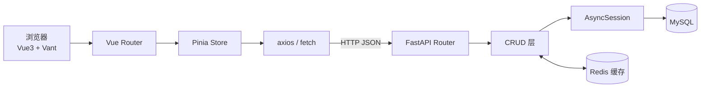
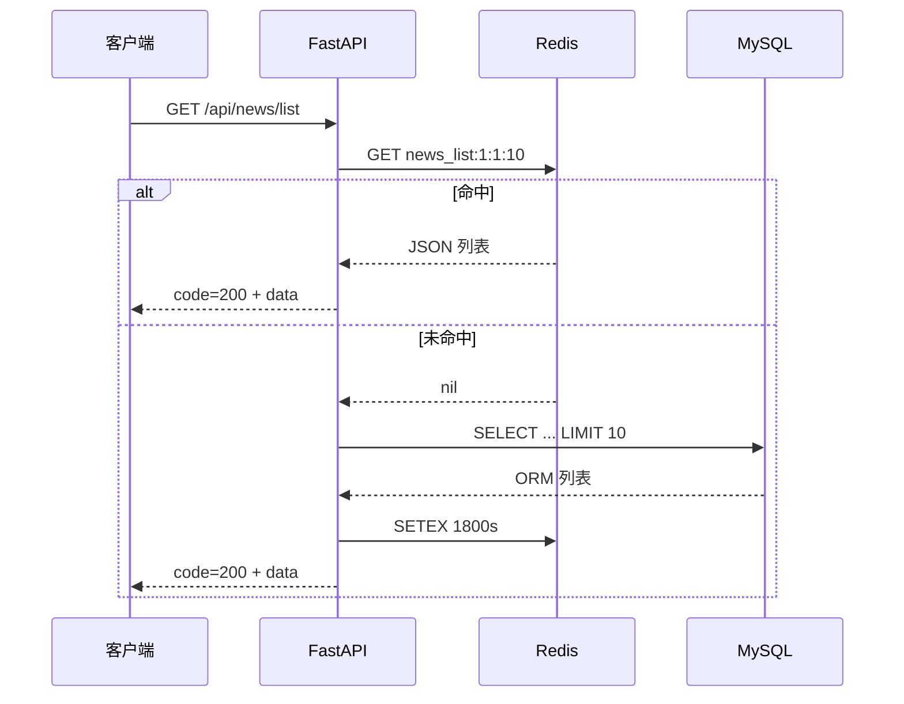

# 01. 项目全景：这次只讲新东西

上一个阶段的两篇笔记已经打好了底子：

- [《FastAPI 从入门到异步数据库实战》](/article/FastAPI)：路由、Path/Query/Field 校验、响应、中间件、依赖注入、异步 SQLAlchemy 的增删改查；
- [《Vue3的学习》](/article/05.vue3)：`<script setup>`、`ref`/`computed`/`watch`、生命周期、父子通信、Pinia 基础。

这次的「黑马头条」不是练习题，而是一个前后端分离的完整项目：

| 项目 | 技术栈 |
| --- | --- |
| 前端 · `xwzx-news` | Vue 3.5 + Vite 7 + Vue Router 4 + Pinia 3 + Vant 4 + vue-i18n 9 + axios + marked + DOMPurify |
| 后端 · `itheima_toutiao_backend` | FastAPI 0.143 + Pydantic 2.14 + SQLAlchemy 2.1（异步）+ aiomysql + Redis 5 + passlib/bcrypt |

本地目录：前端 `D:\code\xwzx-news`，后端 `D:\Projects\PycharmProjects\itheima_toutiao_backend`。

所以这篇不再重复"怎么写一个路由""怎么查一张表"，而是记录项目里真正新增的工程能力：

- 后端：**分层结构、APIRouter、统一响应体、全局异常处理、密码加密与认证依赖、联表查询、Redis 缓存**；
- 前端：**Vue3 项目工程化、路由懒加载与 keep-alive、Vant 移动端组件、i18n、CSS 变量主题、SSE 流式 AI 问答**；
- 两端之间：**camelCase / snake_case 的数据契约、CORS、Token 传递、分页与错误码约定**。

项目整体链路：



一个典型请求的完整路径：**点开首页 → 拉分类 → 拉新闻列表 → 点进详情 → 浏览数 +1 → 记录历史 → 加载相关推荐**。这条路径会把下面大部分知识点串起来。

# 02. 后端工程化：从单文件到分层项目

之前的练习是 `main.py` 一把梭，这个项目开始按职责拆目录：

| 目录 | 职责 | 典型文件 |
| --- | --- | --- |
| `routers/` | 接收 HTTP 请求、参数校验、调用 CRUD、返回响应 | `news.py`、`users.py` |
| `crud/` | 纯数据库操作，不关心 HTTP | `users.py`、`favorite.py` |
| `models/` | SQLAlchemy ORM 模型 | `news.py`、`users.py` |
| `schemas/` | Pydantic 请求/响应模型（数据契约） | `users.py`、`favorite.py` |
| `config/` | 数据库、Redis 连接 | `db_config.py`、`cache_conf.py` |
| `cache/` | 缓存 key 与读写封装 | `news_cache.py` |
| `utils/` | 认证、密码、统一响应、异常处理 | `auth.py`、`security.py` |

## 2.1 APIRouter：把路由拆成模块

每个业务模块建一个 `APIRouter`，带上统一前缀和文档标签：

```python
from fastapi import APIRouter

router = APIRouter(prefix="/api/news", tags=["news"])

@router.get("/list")
async def get_news(...):
    ...
```

然后在 `main.py` 里一次性挂载：

```python
app.include_router(news.router)
app.include_router(users.router)
app.include_router(favorite.router)
app.include_router(history.router)
```

对比单文件写法的收益：

- 路由前缀只写一次，改 `/api/v1/news` 时不用逐个改；
- `tags` 会把同一模块的接口归到 `/docs` 的同一组；
- 每个文件只关心自己的业务，冲突和合并都更少。

## 2.2 CORS：前后端分离必须迈过的坎

前端跑在 `localhost:5173`，后端跑在 `127.0.0.1:8000`，**端口不同就是跨域**。浏览器的同源策略会拦下响应，所以后端要显式放行：

```python
from starlette.middleware.cors import CORSMiddleware

app.add_middleware(
    CORSMiddleware,
    allow_origins=["*"],
    allow_credentials=True,
    allow_methods=["*"],
    allow_headers=["*"],
)
```

| 参数 | 作用 |
| --- | --- |
| `allow_origins` | 允许哪些来源（协议 + 域名 + 端口） |
| `allow_credentials` | 是否允许携带 Cookie 等凭证 |
| `allow_methods` | 允许的 HTTP 方法 |
| `allow_headers` | 允许携带的请求头（如 `Authorization`） |

这里有一个容易被忽略的细节：**`allow_origins=["*"]` 和 `allow_credentials=True` 同时出现时，Starlette 不会真的返回 `*`**，而是把请求里的 `Origin` 原样回显。这是 CORS 规范的要求（带凭证时不允许通配符），实际效果等于"任何站点都可以带凭证访问"。

所以这套配置只适合本地开发。生产环境应该收敛成白名单：

```python
allow_origins=[
    "https://news.example.com",
    "http://localhost:5173",
],
```

顺带一提：浏览器对 `Authorization`、`Content-Type: application/json` 这类请求会先发一个 `OPTIONS` 预检请求，CORS 中间件会自动处理，不用自己写 `OPTIONS` 路由。

# 03. 数据契约：别名、统一响应与全局异常

前后端最容易吵架的地方，不是业务逻辑，而是"字段到底叫什么、错误到底怎么返回"。

## 3.1 camelCase ↔ snake_case 的别名映射

前端习惯 `categoryId`、`pageSize`、`hasMore`，Python 习惯 `category_id`、`page_size`、`has_more`。项目的做法是：**数据库和 Python 用 snake_case，跨出 HTTP 边界时用 `alias` 转成 camelCase**。

```python
from pydantic import BaseModel, ConfigDict, Field

class NewsItemBase(BaseModel):
    id: int
    title: str
    category_id: int = Field(alias="categoryId")
    publish_time: datetime | None = Field(None, alias="publishedTime")

    model_config = ConfigDict(
        from_attributes=True,   # 允许从 ORM 对象读取属性
        populate_by_name=True,  # 允许用 category_id 这种字段名构造
    )
```

两个配置项的分工：

| 配置 | 作用 | 什么时候需要 |
| --- | --- | --- |
| `alias="categoryId"` | 对外字段名 | 请求体、响应体、查询参数 |
| `populate_by_name=True` | 字段名与别名都能用 | 后端内部用 `category_id=` 构造模型 |
| `from_attributes=True` | 支持 `model_validate(orm_obj)` | ORM 对象直接转 Pydantic |

查询参数也能用别名：

```python
category_id: int = Query(..., alias="categoryId")
page_size: int = Query(10, le=100, alias="pageSize")
```

这样前端发 `?categoryId=1&pageSize=10`，后端函数里仍然是清爽的 `category_id`。

响应侧同理，`has_more`、`related_news`、`is_favorite`、`favorite_time` 都定义了 camelCase 别名：

```python
class FavoriteListResponse(BaseModel):
    list: List[FavoriteNewsItemResponse]
    total: int
    has_more: bool = Field(alias="hasMore")

    model_config = ConfigDict(populate_by_name=True, from_attributes=True)
```

## 3.2 model_validate 与 model_dump：两个方向

这套模型在项目里承担了三种转换：

```python
# 1. ORM → Pydantic（读数据库后组装响应）
user_info = UserInfoResponse.model_validate(user)

# 2. Pydantic → 前端 JSON（camelCase）
data.model_dump(by_alias=True, mode="json")

# 3. Pydantic → Redis JSON（保留 Python 风格字段名）
item.model_dump(by_alias=False, mode="json")
```

`mode="json"` 很关键：`datetime`、`Decimal` 这类类型必须转成字符串/数字才能被 `json.dumps` 序列化，否则写缓存时会直接报错。`by_alias` 则决定输出的是 `categoryId` 还是 `category_id`——**给前端用别名，给自己（缓存）用原字段名**，读缓存时才能直接 `News(**item)`。

## 3.3 统一响应体

项目里所有成功响应都长这样：

```json
{ "code": 200, "message": "success", "data": {} }
```

封装函数：

```python
from fastapi.encoders import jsonable_encoder
from starlette.responses import JSONResponse

def success_response(message: str = "success", data=None):
    content = {"code": 200, "message": message, "data": data}
    return JSONResponse(content=jsonable_encoder(content))
```

`jsonable_encoder` 会自动处理 Pydantic 模型、ORM 对象、`datetime` 等类型，是"统一响应体"能兼容各种 `data` 的关键。

统一响应体的好处：前端只需要判断 `response.data.code === 200`，不用为每个接口写一套解析逻辑。代价是**HTTP 状态码和业务码可能出现两套体系**——这个项目里成功固定 200，失败时 HTTP 状态码与 `code` 基本保持一致，算是一种折中。

> 小改进：给 `success_response` 加泛型 `ApiResponse[T]`，并配合 `response_model`，`/docs` 里就能看到完整响应结构，而不是只有一个 `{}`。

## 3.4 全局异常处理

项目在 `main.py` 里一次性注册了四类异常：

```python
def register_exception_handlers(app):
    app.add_exception_handler(HTTPException, http_exception_handler)
    app.add_exception_handler(IntegrityError, integrity_error_handler)
    app.add_exception_handler(SQLAlchemyError, sqlalchemy_error_handler)
    app.add_exception_handler(Exception, general_exception_handler)
```

| 异常 | 触发场景 | 返回 |
| --- | --- | --- |
| `HTTPException` | 业务主动抛出（401/404/400…） | 原状态码 + `detail` |
| `IntegrityError` | 唯一约束、外键约束冲突 | 400 + 友好提示 |
| `SQLAlchemyError` | 其他数据库错误 | 500 + 通用提示 |
| `Exception` | 所有未捕获异常 | 500 + 通用提示 |

异常处理器统一输出同一个信封：

```python
return JSONResponse(
    status_code=status.HTTP_400_BAD_REQUEST,
    content={"code": 400, "message": "用户名已存在", "data": None},
)
```

这样前端永远只处理一种错误结构，不会出现"有的接口返回字符串、有的返回对象"。

但项目里有两个必须知道的坑：

1. **`DEBUG_MODE = True` 会把 `traceback`、SQL 原文、请求路径放进响应 `data`**。教学环境很方便，生产环境等于把内部结构送给攻击者，上线前必须关掉，详细错误只进日志。
2. **`IntegrityError` 的处理把"Duplicate entry"一律翻译成"用户名已存在"**。收藏表也有唯一约束 `(user_id, news_id)`，重复收藏时会错误地提示"用户名已存在"。更稳妥的做法是读 `exc.orig` 里的索引名分别判断，或者统一返回"数据已存在"。

# 04. 认证与安全：bcrypt + 数据库 Token

这个项目没有用 JWT，而是**数据库令牌**：密码用 bcrypt 哈希存储，登录后生成一个 UUID Token 存进 `user_token` 表，前端之后带着它访问受保护接口。

## 4.1 密码只存哈希

```python
from passlib.context import CryptContext

pwd_context = CryptContext(schemes=["bcrypt"], deprecated="auto")

def get_password_hash(password: str) -> str:
    return pwd_context.hash(password)

def verify_password(plain_password: str, hashed_password: str) -> bool:
    return pwd_context.verify(plain_password, hashed_password)
```

要点：

- 数据库里永远不存明文密码，只存 bcrypt 哈希；
- bcrypt 的盐值已经编码在哈希字符串里，不需要单独存一列；
- 校验时用 `verify`，不要自己比较哈希字符串（bcrypt 每次加盐结果都不同）；
- `models.users.User.password` 给了 `String(255)`，长度足够放下 bcrypt 哈希。

## 4.2 Token 表与"单设备会话"

```python
token = str(uuid.uuid4())                       # 122 位随机性
expires_at = datetime.now() + timedelta(days=7) # 7 天有效期
```

`create_token` 的逻辑是：先按 `user_id` 查已有令牌，存在就更新，不存在就插入。**一个用户只保留一条令牌记录**，所以重新登录会让旧设备立刻失效，语义上是"单设备会话"。

校验令牌：

```python
async def get_user_by_token(db: AsyncSession, token: str):
    result = await db.execute(select(UserToken).where(UserToken.token == token))
    user_token = result.scalar_one_or_none()
    if not user_token or user_token.expires_at < datetime.now():
        return None
    result = await db.execute(select(User).where(User.id == user_token.user_id))
    return result.scalar_one_or_none()
```

## 4.3 依赖注入做认证

```python
from fastapi import Header, Depends, HTTPException

async def get_current_user(
    authorization: str = Header(..., description="Authorization"),
    db: AsyncSession = Depends(get_db),
):
    token = authorization.replace("Bearer ", "")
    user = await get_user_by_token(db, token)
    if not user:
        raise HTTPException(status_code=401, detail="无效的令牌或令牌已过期")
    return user
```

受保护接口只需要声明依赖：

```python
@router.get("/info")
async def user_info(user: User = Depends(get_current_user)):
    return success_response(data=UserInfoResponse.model_validate(user))
```

这就是依赖注入在真实项目里的样子：**认证逻辑只写一次，路由只声明"我需要当前用户"**。

## 4.4 数据库 Token 与 JWT 的取舍

| 维度 | 数据库 Token（本项目） | JWT |
| --- | --- | --- |
| 服务端是否存状态 | 存，一张表 | 不存（无状态） |
| 校验成本 | 每次请求查库（可加 Redis） | 验签即可 |
| 主动失效 | 删/改记录即可 | 需要黑名单或版本号 |
| 水平扩展 | 依赖共享数据库 | 天然适合多实例 |
| 适用场景 | 中小项目、需要强控制会话 | 微服务、无状态网关 |

这里没有绝对优劣，只有取舍。当前实现每请求查两次库（token 表 + user 表），用户量上来后可以把 token → user_id 的映射塞进 Redis，或者直接换 JWT。

## 4.5 这套认证还缺什么

- **没有退出登录接口**：前端 `logout()` 只清本地 Pinia，数据库里的 Token 仍然有效 7 天。正确做法是加 `POST /api/user/logout` 删除 Token 记录；
- **Token 传输格式不统一**：前端发的是裸 `Authorization: <token>`，后端用 `replace("Bearer ", "")` 兼容两种写法。建议统一成标准的 `Authorization: Bearer <token>`，并用 `HTTPBearer` / `OAuth2PasswordBearer` 解析；
- **Token 存在 localStorage**：省事，但一旦页面有 XSS，Token 就能被脚本读走。更安全的方案是 HttpOnly Cookie + CSRF 防护；
- **密码策略太弱**：注册只校验非空，建议加最小长度、复杂度、失败次数限制。

# 05. 数据建模与查询进阶

## 5.1 索引、唯一约束与外键

项目对高频查询字段建了索引，对"不能重复"的业务建了唯一约束：

```python
class Favorite(Base):
    __tablename__ = "favorite"

    __table_args__ = (
        UniqueConstraint("user_id", "news_id", name="user_news_unique"),
        Index("fk_favorite_user_idx", "user_id"),
        Index("fk_favorite_news_idx", "news_id"),
    )
```

| 设计 | 作用 |
| --- | --- |
| `ForeignKey(User.id)` | 数据库层面保证关联数据存在 |
| `Index(...)` | 加速 `where user_id = ?` 这类高频查询 |
| `UniqueConstraint(user_id, news_id)` | 防止同一用户重复收藏同一篇新闻 |

新闻表还给 `category_id`、`publish_time` 建了索引，因为列表页最常按分类过滤、按时间排序。**索引不是越多越好**：写多读少的表加太多索引会拖慢插入和更新。

## 5.2 时间字段的两个真实坑

**坑一：`default=datetime.now()` 是"导入时求值"。**

```python
# models/users.py（有问题）
created_at: Mapped[datetime] = mapped_column(DateTime, default=datetime.now())
```

外层括号让它在**模块加载的那一刻**就执行了，之后所有用户的创建时间都是同一个值。正确写法是传函数本身：

```python
created_at: Mapped[datetime] = mapped_column(DateTime, default=datetime.now)
updated_at: Mapped[datetime] = mapped_column(
    DateTime, default=datetime.now, onupdate=datetime.now
)
```

**坑二：`datetime.utcnow` 与 `datetime.now` 混用。**

收藏表用 `default=datetime.utcnow`（UTC，且 Python 3.12 起已弃用），新闻和历史用 `datetime.now`（本地时间）。两种时间混在一起排序、展示，会出现"刚收藏的排到 8 小时后"之类的错位。建议全项目统一用带时区的 `datetime.now(timezone.utc)`，展示时再转本地时区；或者在数据库层统一使用 `func.now()`。

**坑三：每个模型文件各建了一个 `DeclarativeBase`。**

项目里 `models/news.py`、`models/users.py`、`models/favorite.py`、`models/history.py` 各自定义了 `Base`，等于有四套 `metadata`。后果是 `Base.metadata.create_all()` 只能建出其中一个模块的表，Alembic 自动迁移也拿不到全量模型。正确做法是全项目共用一个 `Base`（比如放在 `models/base.py`），各模型只 `from models.base import Base`。

## 5.3 联表查询与 tuple 解包

收藏列表要把"新闻信息 + 收藏时间 + 收藏 ID"一起返回，做法是显式 join：

```python
query = (
    select(
        News,
        Favorite.created_at.label("favorite_time"),
        Favorite.id.label("favorite_id"),
    )
    .join(Favorite, News.id == Favorite.news_id)
    .where(Favorite.user_id == user_id)
    .order_by(Favorite.created_at.desc())
    .offset((page - 1) * page_size)
    .limit(page_size)
)
rows = (await db.execute(query)).all()
```

返回的每一行是一个元组，路由层这样拆：

```python
favorite_list = [{
    **news.__dict__,
    "favorite_time": favorite_time,
    "favorite_id": favorite_id,
} for news, favorite_time, favorite_id in rows]
```

`label("favorite_time")` 给查询列起别名，元组解包时语义更清楚。这种方式比给 ORM 加 `relationship` 更直接，适合"只查、不级联操作"的场景。

## 5.4 原子自增：别用"读出来 +1 再写回去"

浏览量 +1 用的是数据库表达式：

```python
stmt = update(News).where(News.id == news_id).values(views=News.views + 1)
result = await db.execute(stmt)
return result.rowcount > 0
```

`News.views + 1` 会生成 `UPDATE news SET views = views + 1`，由数据库保证原子性。如果写成"查询出 views，加 1，再赋值提交"，并发下两个请求可能都读到 100，最后都写成 101，丢了一次浏览。

`rowcount` 则是判断"这次更新到底有没有命中行"的常用手段：0 表示记录不存在，可以直接转 404。

## 5.5 分页与 hasMore

前端传的是"页码 + 每页数量"：

```python
offset = (page - 1) * page_size
...
"hasMore": total > offset + len(news_list)
```

`hasMore` 的判断比"当前页是否满页"更可靠：最后一页刚好 10 条时，满页不代表还有下一页，用总数比较就不会多请求一次。

## 5.6 历史记录的"存在则更新"

浏览历史的要求是"同一篇新闻只保留一条，重复浏览更新时间"：

```python
existing = (await db.execute(
    select(History).where(History.user_id == user_id, History.news_id == news_id)
)).scalar_one_or_none()

if existing:
    existing.view_time = datetime.now()
else:
    db.add(History(user_id=user_id, news_id=news_id))
```

这是"先查后写"的 upsert。并发下两个请求可能同时查不到、同时插入，产生重复记录——因为 `history` 表**没有** `(user_id, news_id)` 唯一约束。更稳的做法是加唯一约束，然后用数据库的 `INSERT ... ON DUPLICATE KEY UPDATE`（MySQL）或 `ON CONFLICT`（PostgreSQL）。

# 06. Redis 缓存：cache-aside 实战

新闻分类、列表、详情、相关推荐都是读多写少的数据，非常适合缓存。项目用的是 **cache-aside（旁路缓存）**：读时先查缓存，没有再查库并回填；写时更新数据库，再处理缓存。

## 6.1 异步 Redis 客户端

```python
import redis.asyncio as redis

redis_client = redis.Redis(
    host="localhost",
    port=6379,
    db=0,
    decode_responses=True,  # 返回 str 而不是 bytes
)
```

`decode_responses=True` 省去了到处 `.decode()` 的麻烦，代价是二进制数据不适合走这个连接。

缓存读写封装：

```python
async def set_cache(key: str, value, expire: int = 3600):
    try:
        if isinstance(value, (dict, list)):
            value = json.dumps(value, ensure_ascii=False)
        await redis_client.setex(key, expire, value)
        return True
    except Exception as e:
        print(f"设置缓存失败：{e}")
        return False
```

两个细节：

- `ensure_ascii=False` 让中文原样存储，方便用 Redis 客户端直接查看；
- `setex` 一条命令完成"设值 + 过期"，避免 `set` 之后忘记 `expire`。

## 6.2 缓存 key 设计与 TTL

| 数据 | key 模板 | TTL |
| --- | --- | --- |
| 分类 | `news:categories` | 7200s（2h） |
| 新闻列表 | `news_list:{category_id}:{page}:{size}` | 1800s |
| 新闻详情 | `news:detail:{news_id}` | 300s |
| 相关新闻 | `news:related:{news_id}:{category_id}` | 1800s |

TTL 的设计原则是**数据越稳定，缓存越久**：分类几乎不变，可以 2 小时；详情可能被编辑，5 分钟；列表介于两者之间。

给不同 key 设置不同过期时间，还能避免"同一时刻全部失效"造成的**缓存雪崩**。注释里也写了这一点：如果所有 key 都是 3600 秒且同时写入，整点会出现一波全部打回数据库的流量。生产环境还可以再给 TTL 加一点随机抖动（比如 ±10%）。

## 6.3 完整的读取链路



项目里 ORM 与缓存之间的转换链是：

```python
# 写缓存：ORM → Pydantic → dict（JSON 安全）
news_data = [
    NewsItemBase.model_validate(item).model_dump(mode="json", by_alias=False)
    for item in news_list
]

# 读缓存：dict → ORM（保持后续代码不改）
cached = await get_cache_news_list(category_id, page, limit)
if cached:
    return [News(**item) for item in cached]
```

这种"读出来再变回 ORM 对象"的写法能让缓存层对上层透明，但也要注意：这些是**游离对象**，不能拿去 `db.delete()` 或做关联懒加载。

## 6.4 缓存失败要"降级"，不能"拖死"

```python
async def get_cache(key: str):
    try:
        return await redis_client.get(key)
    except Exception as e:
        print(f"读取缓存失败：{e}")
        return None
```

Redis 挂了时返回 `None`，请求自动回源数据库——这是**fail-open**（缓存故障不影响主流程）。如果反过来让异常冒泡，Redis 一挂整个新闻接口都 500，就本末倒置了。

不过 `print` 只能算教学写法，生产环境应该用日志 + 监控指标，至少能知道"缓存命中率掉到 0 了"。

## 6.5 这套缓存的一致性隐患

项目里有几个值得警惕的点：

1. **浏览量更新不刷新详情缓存**：`increase_news_views` 只更新 MySQL，详情缓存仍是旧的 `views`，最长 5 分钟内都看不到增长；而且接口返回的 `new_detail.views` 是自增前的值，天然少 1。
2. **列表缓存没有失效策略**：一旦有了"发布/编辑/删除新闻"的写接口，必须同步删除对应分类的列表缓存，否则用户会看到"新文章发布了但列表没有"。
3. **空列表不缓存**：`if news_list:` 才写缓存，空结果每次都会打数据库；如果遇到恶意刷不存在的分类，就是典型的缓存穿透。
4. **不存在的数据没有空值标记**：详情查询不存在的 id 时，每次都查库。可以缓存 `"__EMPTY__"` 之类的短 TTL 标记。
5. **详情缓存与相关推荐分开**：详情缓存里排除了 `related_news`，相关推荐单独一个 key。两段数据可能来自不同时间点，一致性只能靠 TTL 兜底。

更好的写法是"**更新数据库后删除缓存**"（而不是更新缓存），让下一次读请求自然回填，减少并发写导致的脏数据。

# 07. 前端工程：Vue3 项目骨架

## 7.1 入口文件与插件顺序

```js
const app = createApp(App)

app.use(i18n)      // 国际化
app.use(Button)    // Vant 组件逐个注册
app.use(router)    // 路由
app.use(pinia)     // 状态管理

app.mount('#app')
```

一个容易忽略的点：**如果路由守卫里要用 Pinia store，`app.use(pinia)` 必须放在 `app.use(router)` 之前**。当前项目的守卫只设置标题，所以顺序不影响；但一旦加上"未登录跳转登录页"的判断，顺序错了会在守卫里报"no active Pinia"。

主题初始化写在挂载之后：

```js
const themeStore = useThemeStore()
themeStore.initTheme()
```

因为此时 `app.use(pinia)` 已经执行，`useThemeStore()` 才能拿到当前激活的 Pinia 实例。

## 7.2 路由：懒加载 + meta + keep-alive

```js
const routes = [
  {
    path: '/home',
    name: 'Home',
    component: () => import('../views/Home.vue'), // 路由级懒加载
    meta: { title: '首页', keepAlive: true }
  },
  {
    path: '/news/detail/:id',
    name: 'NewsDetail',
    component: () => import('../views/NewsDetail.vue'),
    meta: { title: '新闻详情', keepAlive: false }
  }
]
```

三个工程化要点：

- **懒加载**：`() => import(...)` 让每个页面单独打包，首屏不用下载全部页面；
- **meta.title**：守卫统一设置 `document.title = to.meta.title`，不用每个页面自己写；
- **meta.keepAlive**：根组件根据它决定是否缓存页面。

根组件里配合 `<keep-alive>`：

```vue
<router-view v-slot="{ Component }">
  <keep-alive v-if="$route.meta.keepAlive">
    <component :is="Component" />
  </keep-alive>
  <component v-else :is="Component" />
</router-view>
```

被缓存的页面从详情页返回时不会重新挂载，滚动位置、已加载的列表都还在——这就是"首页 → 详情 → 返回首页不重新请求"的实现方式。

代价是：**`onMounted` 只会执行一次**。如果缓存页面需要在每次进入时刷新数据，要用 `onActivated`，或者像项目这样 `watch` 路由参数：

```js
watch(
  () => route.query.categoryId,
  (newId) => {
    if (newId) {
      activeTab.value = index
      newsStore.changeCategory(parseInt(newId))
    }
  },
  { immediate: true }
)
```

## 7.3 移动端适配：750px 设计稿

```html
<meta name="viewport" content="width=device-width, initial-scale=1.0, maximum-scale=1.0, user-scalable=no, viewport-fit=cover">
```

```css
.app {
  max-width: 750px;
  margin: 0 auto;
}

@media screen and (max-width: 750px) {
  html {
    font-size: calc(100vw / 750 * 16);
  }
}
```

思路是"设计稿宽 750px，1rem 按视口宽度缩放"。但要清楚：**只有用 rem 写的尺寸会跟着缩放**。项目里大量样式仍是 px，所以实际是"px + 部分 rem"的混合方案。如果要严格适配，要么全部用 rem/vw，要么用 `postcss-px-to-viewport` 之类的插件统一转换。

`viewport-fit=cover` 则是给刘海屏留出安全区，配合 `env(safe-area-inset-bottom)` 处理底部 TabBar 更稳。

## 7.4 Pinia 的模块划分

| store | 职责 |
| --- | --- |
| `user` | 登录状态、Token、用户信息、资料/密码修改 |
| `news` | 分类、列表、详情、分页状态 |
| `favorite` | 收藏列表与收藏/取消收藏 |
| `history` | 浏览历史增删清空 |
| `theme` | 主题配置与 CSS 变量 |
| `language` | 当前语言 |

跨 store 调用的写法：

```js
import { useUserStore } from '../user'

export const useFavoriteStore = defineStore('favorite', {
  actions: {
    async addFavoriteApi(newsId) {
      const userStore = useUserStore() // 在 action 内部调用
      if (!userStore.getLoginStatus) return { success: false, message: '请先登录' }
      ...
    }
  }
})
```

注意 `useUserStore()` 要写在 action 内部，而不是模块顶层——模块顶层拿不到当前应用的 Pinia 实例。

## 7.5 持久化插件：v4 的配置变了

项目安装的是 `pinia-plugin-persistedstate` v4，但 `user` store 里还是旧写法：

```js
// 旧版本（v3 及以前）的写法，v4 已不支持
persist: {
  enabled: true,
  strategies: [
    { key: 'user-store', storage: localStorage }
  ]
}
```

v4 的正确写法是直接写在 `persist` 上：

```js
persist: {
  key: 'user-store',
  storage: localStorage,
  pick: ['token', 'userInfo', 'isLogin'], // 只持久化需要的字段
}
```

当前配置在 v4 下 `enabled` 和 `strategies` 会被忽略，实际使用默认 key（store id）持久化整个 state。功能"看起来能用"，但 key 名、字段范围都和预期不一致——这类升级坑很难靠肉眼发现，建议直接用 DevTools 看 localStorage。

另外项目里同时存在三种持久化方式：插件、`theme`/`language` 手写 `localStorage`、收藏/历史手写 `localStorage`。统一成一套会更好维护。

# 08. Vant 4：移动端组件实战

## 8.1 下拉刷新 + 上拉加载

```vue
<van-pull-refresh v-model="newsStore.refreshing" @refresh="onRefresh">
  <van-list
    v-model:loading="newsStore.loading"
    :finished="newsStore.finished"
    finished-text="没有更多了"
    @load="onLoad"
  >
    <news-item v-for="item in newsStore.newsList" :key="item.id" :news="item" />
  </van-list>
</van-pull-refresh>
```

```js
const onRefresh = () => newsStore.getNewsList(true) // 回到第 1 页
const onLoad = () => newsStore.getNewsList()         // 追加下一页
```

`van-list` 的工作机制：内容滚动到底部时触发 `load`，加载完成必须把 `loading` 设回 `false`；没有更多数据时把 `finished` 设为 `true`，否则会无限触发。

页码计算：

```js
page: isRefresh ? 1 : Math.ceil(this.newsList.length / 10) + 1
```

用"已有条数 ÷ 每页条数 + 1"推算下一页，适合"每页都是满的"场景。如果后端可能返回空页或不满页，更稳的是单独维护 `page` 变量。

## 8.2 表单校验

```vue
<van-field
  v-model="username"
  :rules="[{ required: true, message: '请填写用户名' }]"
/>

<van-field
  v-model="confirmPassword"
  :rules="[
    { required: true, message: '请确认密码' },
    { validator: () => password === confirmPassword, message: '两次密码不一致' }
  ]"
/>
```

`van-form` 会在提交前跑完所有规则，全部通过才触发 `@submit`。自定义 `validator` 返回 `true/false` 即可，复杂规则也可以返回 Promise。

## 8.3 Toast / Dialog 的 Vant 4 变化

项目里大量使用：

```js
showToast({ type: 'loading', message: '登录中...', duration: 0 })
showDialog({ title: '提示', showCancelButton: true })
```

但 `Profile.vue` 的异常分支里还留着 Vant 2/3 的旧 API：

```js
showToast.clear()
showToast.fail('获取用户信息失败')
```

在 Vant 4.9 里，`showToast` 是一个函数，**没有 `.clear` 和 `.fail` 方法**，这两个调用会抛 `TypeError`。对应的新 API 是：

```js
import { closeToast, showFailToast } from 'vant'

closeToast()
showFailToast('获取用户信息失败')
```

另外，Vant 的 Toast 默认是单例：连续调用 `showToast` 会复用同一个实例并更新内容。需要同时显示多个 Toast 时，要调用 `allowMultipleToast()`。

## 8.4 `:deep()` 修改子组件样式

```css
:deep(.van-tab--active) {
  font-weight: bold;
  color: #1989fa;
}
```

`<style scoped>` 会把样式限制在当前组件，但 Vant 组件内部的 DOM 不属于当前组件作用域，所以要靠 `:deep()` 穿透。这是用第三方组件库时最常见的样式处理方式。

# 09. i18n 与主题切换

## 9.1 vue-i18n 的组合式用法

```js
import { createI18n } from 'vue-i18n'

const i18n = createI18n({
  legacy: false,                    // 使用组合式 API
  locale: localStorage.getItem('language') || 'zh-CN',
  fallbackLocale: 'zh-CN',
  messages: {
    'zh-CN': zhCN,
    'en-US': enUS,
  },
})
```

```js
const { t, locale } = useI18n()
locale.value = 'en-US'       // 切换语言
document.documentElement.setAttribute('lang', locale.value)
```

模板里用 `$t('nav.home')`，脚本里用 `t('nav.home')`。`fallbackLocale` 保证某个 key 在英文里漏翻时自动回退到中文，而不是显示原始 key。

一个设计问题：后端返回的分类名是中文（`头条`、`社会`…），前端用一张映射表转成 `home.categories.headline`。这能工作，但**数据层和展示层耦合了**——后端多加一个分类，前端就要同步改映射，否则英文界面会露出中文。更稳的做法是后端返回稳定的分类 `code`，前端按 code 翻译。

## 9.2 主题：CSS 变量 + Store

```js
const themes = {
  light: { backgroundColor: '#ffffff', textColor: '#333333', primaryColor: '#1989fa' },
  dark:  { backgroundColor: '#121212', textColor: '#ffffff', primaryColor: '#4c8bf5' },
  blue:  { backgroundColor: '#e6f7ff', textColor: '#333333', primaryColor: '#1890ff' },
  green: { backgroundColor: '#f6ffed', textColor: '#333333', primaryColor: '#52c41a' },
}

applyTheme() {
  const theme = this.themes[this.currentTheme]
  document.documentElement.style.setProperty('--background-color', theme.backgroundColor)
  document.documentElement.style.setProperty('--text-color', theme.textColor)
  document.documentElement.style.setProperty('--primary-color', theme.primaryColor)
}
```

页面里用 `var(--background-color)` 等变量，切换主题时只需要改根元素上的变量值，所有引用处自动更新——这是 CSS 变量最大的价值。

注意两点：

1. Vant 自己有一套主题变量（`--van-primary-color` 等），只改自定义的 `--primary-color` 不会自动改变 Vant 组件的主色。要统一，得额外覆盖 Vant 的变量；
2. 主题选择用 `localStorage` 持久化，初始化时必须在 Pinia 可用之后调用 `initTheme()`，否则首屏会闪一下默认主题。

# 10. AI 问答：浏览器端 SSE 流式渲染

项目里的 AI 问答没有走自己的后端，而是前端直接请求阿里云 DashScope 的兼容接口，用 SSE 实现"边生成边显示"。

## 10.1 请求与流式读取

```js
const response = await fetch(apiEndpoint, {
  method: 'POST',
  headers: {
    'Content-Type': 'application/json',
    'Authorization': `Bearer ${apiKey}`,
    'X-DashScope-SSE': 'enable',
  },
  body: JSON.stringify({ model, messages, stream: true }),
})

const reader = response.body.getReader()
const decoder = new TextDecoder()
let buffer = ''
let text = ''

while (true) {
  const { done, value } = await reader.read()
  if (done) break

  buffer += decoder.decode(value, { stream: true })
  const lines = buffer.split('\n')
  buffer = lines.pop() || ''   // 最后一行可能是不完整的，留到下一次

  for (const line of lines) {
    if (!line.startsWith('data: ')) continue
    const data = line.slice(6)
    if (data === '[DONE]') continue
    text += JSON.parse(data).choices?.[0]?.delta?.content || ''
    messages.value[messages.value.length - 1].content = text
  }
}
```

这段代码有四个关键点：

| 关键点 | 原因 |
| --- | --- |
| `decoder.decode(value, { stream: true })` | 一个 UTF-8 汉字可能被拆在两个 chunk 里，必须用流式解码 |
| `buffer.split('\n')` + `pop()` | 网络分片不等于按行分片，最后一行要留到下次拼接 |
| `data: ` 前缀与 `[DONE]` | SSE 协议格式，结束标记不能当 JSON 解析 |
| 增量更新最后一条消息 | 只改最后一条 assistant 消息，前面的消息保持不变 |

## 10.2 Markdown 渲染与 XSS 防护

```js
import { marked } from 'marked'
import DOMPurify from 'dompurify'

const formatMessage = (content) =>
  DOMPurify.sanitize(marked.parse(content))
```

```vue
<div v-html="formatMessage(message.content)"></div>
```

`v-html` 会原样插入 HTML，如果直接渲染模型返回的内容，就等于把 XSS 入口交给模型输出。**先 `marked` 转 Markdown，再 `DOMPurify.sanitize` 清洗，最后才 `v-html`**——这个顺序不能反，也不能省。项目这一点做对了，值得保留。

## 10.3 SSE / WebSocket / 轮询怎么选

| 方案 | 通信方向 | 适用场景 |
| --- | --- | --- |
| 轮询 | 客户端反复问 | 实现最简单，实时性差、浪费请求 |
| SSE | 服务端单向推送 | 大模型流式输出、日志、通知 |
| WebSocket | 双向实时 | 聊天室、协同编辑、游戏 |

AI 问答只需要"服务端持续往客户端推 token"，SSE 足够，没必要上 WebSocket。

## 10.4 这个实现里的安全与工程问题

**最严重的问题：API Key 直接写在前端配置里。**

```js
export const aiChatConfig = {
  apiEndpoint: 'https://dashscope.aliyuncs.com/...',
  apiKey: 'sk-...',
  model: 'qwen3-max-preview',
}
```

前端代码是公开的，打包后 `sk-...` 就在 JS 文件里，任何人打开 DevTools 都能拿到并盗刷额度。正确做法是**后端代理**：前端请求自己的 `/api/ai/chat`，后端拿着服务端环境变量里的 Key 调用大模型，再用 `StreamingResponse` 把流透传给前端。

其他改进点：

- 没有 `AbortController`，用户离开页面或重新提问时旧请求停不下来；
- 没有重试与超时；
- 每收到一个 chunk 都触发 `deep watch` + `nextTick` + 重新 `marked` 整个消息，长回答时会明显卡顿；
- 对话只存在内存里，刷新即丢；
- 第三方接口的 CORS 策略不受自己控制，换模型供应商可能直接失败。

# 11. 前后端联调：数据契约与踩坑清单

## 11.1 一张表看懂字段映射

| 前端（camelCase） | 后端（snake_case） | 位置 |
| --- | --- | --- |
| `categoryId` | `category_id` | 查询参数/响应 |
| `pageSize` | `page_size` | 查询参数 |
| `publishTime` | `publish_time` | 响应 |
| `relatedNews` | `related_news` | 详情响应 |
| `hasMore` | `has_more` | 列表响应 |
| `isFavorite` | `is_favorite` | 收藏检查响应 |
| `favoriteTime` | `favorite_time` | 收藏列表 |
| `viewTime` | `view_time` | 历史列表 |

映射靠后端的 `Field(alias=...)` + `populate_by_name=True`。联调时如果发现前端拿到 `undefined`，第一反应应该是**看响应 JSON 的 key**，而不是怀疑组件。

## 11.2 响应信封与错误码

```json
{
  "code": 200,
  "message": "success",
  "data": {}
}
```

| HTTP 状态 | 典型场景 | 前端处理 |
| --- | --- | --- |
| 200 | 成功 | 取 `data` |
| 400 | 用户名已存在、参数业务校验失败 | Toast 提示 `message` |
| 401 | Token 无效/过期 | 清空登录态，跳登录页 |
| 404 | 新闻/收藏/历史不存在 | 空态或提示 |
| 422 | Pydantic 校验失败 | 表单错误提示 |
| 500 | 数据库/未知异常 | 通用错误提示 |

前端目前是"每个 action 自己 try/catch"，重复代码很多。更工程化的做法是 axios 响应拦截器统一处理：

```js
const http = axios.create({ baseURL: import.meta.env.VITE_API_BASE_URL })

http.interceptors.request.use((config) => {
  const token = localStorage.getItem('token')
  if (token) config.headers.Authorization = `Bearer ${token}`
  return config
})

http.interceptors.response.use(
  (res) => res.data,
  (error) => {
    if (error.response?.status === 401) {
      // 清理登录态并跳转
    }
    return Promise.reject(error)
  }
)
```

顺手还能把 `baseURL` 从硬编码改成 `import.meta.env.VITE_API_BASE_URL`，本地/测试/生产用不同的 `.env` 文件。

## 11.3 本轮踩坑清单

| # | 位置 | 问题 | 改进 |
| --- | --- | --- | --- |
| 1 | `models/users.py` | `default=datetime.now()` 在导入时求值，所有用户时间相同 | 改成 `default=datetime.now` |
| 2 | `models/*.py` | 四个文件各自定义 `DeclarativeBase`，metadata 分裂 | 统一一个 `models/base.py` |
| 3 | `utils/exception.py` | Debug 模式把 traceback 返回给客户端 | 生产关闭，详细错误只进日志 |
| 4 | `utils/exception.py` | 所有 Duplicate entry 都提示"用户名已存在" | 按索引名判断或返回通用提示 |
| 5 | `utils/auth.py` + 前端 | Token 传裸值，后端兼容 `Bearer` | 统一 `Authorization: Bearer <token>` |
| 6 | `routers/users.py` | 没有登出接口，Token 7 天内始终有效 | 增加 `/logout` 删除 Token |
| 7 | `routers/favorite.py` | 依赖类型写成同步 `Session` | 改为 `AsyncSession` |
| 8 | `routers/history.py` | 路径参数叫 `history_id`，实际按 `news_id` 删除 | 重命名参数，避免语义误导 |
| 9 | `models/history.py` | 缺少 `(user_id, news_id)` 唯一约束，并发 upsert 会重复 | 加唯一约束 + 数据库 upsert |
| 10 | `crud/news_cache.py` | 浏览量更新后缓存仍是旧值 | 更新后删详情缓存或回写 |
| 11 | `crud/news_cache.py` | 空列表不写缓存，存在穿透 | 空结果短 TTL 缓存 |
| 12 | 前端 `config/api.js` | API Key 写死在前端 | 改后端代理 + 环境变量 |
| 13 | 前端 `Profile.vue` | 使用 Vant 2 的 `showToast.clear/fail` | 改 `closeToast` / `showFailToast` |
| 14 | 前端 `store/user.js` | persistedstate v4 仍用 `enabled/strategies` | 改成 `persist: { key, storage, pick }` |
| 15 | 前端 `views/Home.vue` | 两个 `onMounted`，首页重复请求列表 | 合并为一个初始化流程 |
| 16 | 前端路由 | 没有登录守卫，靠页面内判断 | 用 `meta.requiresAuth` + `beforeEach` |
| 17 | 前端 store | 每个 action 重复写 axios 鉴权与错误处理 | 抽 `http` 实例 + 拦截器 |

其中三条最值得单独记住：

**时间默认值要传函数，不要传函数调用结果。** `default=datetime.now` 和 `default=datetime.now()` 只差一对括号，行为却是"每次插入取当前时间"和"模块导入时取一次时间"。

**缓存不是加上了就完事，写操作之后怎么处理才是难点。** 读多写少的新闻列表很适合缓存，但一旦有发布、编辑、删除，就必须设计失效策略，否则用户会看到"旧闻"。

**第三方 Key 永远不要放到浏览器。** 任何 `VITE_` 前缀的环境变量都会被打包进前端产物，只有后端环境变量才是安全的。

# 12. 小结与下一步

这个项目相对上一篇 FastAPI 笔记，新增的能力可以归纳成四组：

- **工程结构**：APIRouter 模块化、router / crud / models / schemas / utils 分层、CORS；
- **接口规范**：Pydantic 别名与 ORM 模式、统一响应体、全局异常处理、bcrypt 密码、数据库 Token 认证；
- **数据能力**：索引与唯一约束、联表查询、原子自增、分页 hasMore、Redis cache-aside 与 TTL 设计；
- **前端实战**：Vue3 组合式 API、路由懒加载与 keep-alive、Pinia 模块化与持久化、Vant 移动端交互、i18n、CSS 变量主题、SSE 流式 Markdown 渲染。

继续往下走，优先级大概是：

1. **统一模型基类 + Alembic**：解决 metadata 分裂和建表/改表问题；
2. **配置外置**：`pydantic-settings` 管数据库、Redis、CORS 白名单、第三方 Key；
3. **认证完善**：标准 Bearer、登出接口、Token 存 Redis、失败次数限制；
4. **缓存治理**：写后删缓存、空值缓存、TTL 抖动、命中率监控；
5. **前端基础设施**：axios 实例与拦截器、路由守卫、全局错误处理、环境变量；
6. **AI 安全**：把大模型调用搬到后端，前端只连自己的流式接口；
7. **测试与部署**：pytest + httpx 测接口，Vite build + Nginx 部署前端，uvicorn/gunicorn 部署后端，Docker Compose 串起 MySQL + Redis + 前后端。

从"能跑通功能"到"能交付的项目"，差距基本都在这份清单里。
